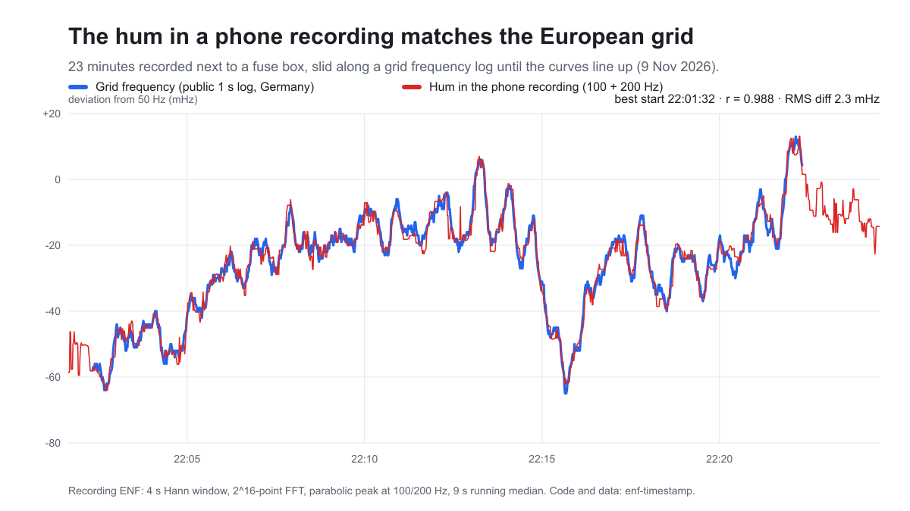
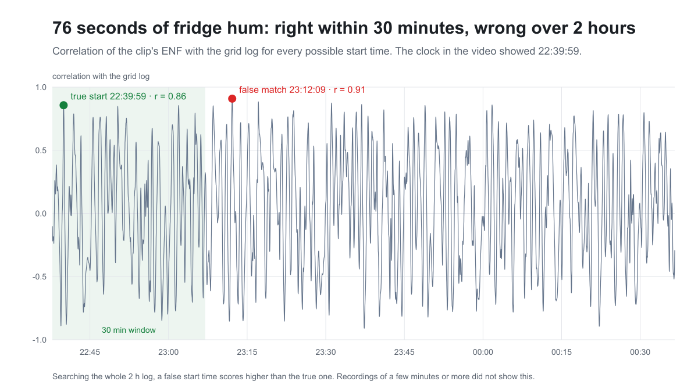

# enf-timestamp

**Find when a recording was made from the mains hum in it.** [Türkçe özet aşağıda](#türkçe).

The mains frequency is never exactly 50 Hz. It drifts by a few mHz from second to second as supply and demand shift, and the drift is the same everywhere in a synchronous grid: for Continental Europe, from Portugal to Turkey. Fridges, fuse boxes and chargers hum at twice that frequency, and a phone microphone picks it up. Sliding the hum's frequency curve along a log of the grid frequency gives the wall-clock time of the recording. In forensics this is called ENF (electrical network frequency) analysis.

This repo is a small, dependency-free Node.js implementation, the data from my first tests, and a test script that reproduces every number below.



## Results

All recordings were made with one phone on 9 November 2026. The reference is a public 1 s grid-frequency feed from Germany, logged while I recorded.

| Recording | Length | Found start | Truth | Notes |
|---|---|---|---|---|
| Next to a fuse box (audio) | 23 min | 22:01:32, r = 0.988, RMS diff 2.3 mHz | not independently known | 9 s smoothing. Within 1 s with 1, 5 and 9 s smoothing |
| Next to the fridge, a clock in frame (video) | 76 s | 22:39:59 within a 30 min window | 22:39:59 on the clock | **Wrong (23:12:09) over the full 2 h log**, see below |
| A ceiling lamp, light only, no hum in the audio (video) | 191 s | 23:38:54, r = 0.930 | 23:38:55 (file end time minus duration) | 100 Hz flicker folds to ≈10 Hz at 30 fps |
| The fuse-box recording with 99 s cut out (blind) | 21 min | cut of 99 s at ≈407 s, removed part starts 22:08:20 | 99 s at 408 s, 22:08:20 | Splice detection with 120 s sliding windows |
| Synthetic hum from the log, in white noise | 5 min | hidden start found to the second | | Part of `npm test` |

### The 76-second clip: a limitation, not a success



In my first blind test, I analysed the fridge video without looking at the clock in the frame and got 22:40:00 (the clock showed 22:39:59). At the time the reference log was only about 15 minutes long. With the full 2 h log, a false match at 23:12:09 scores higher (r = 0.91) than the true start (r = 0.86). **A 76 s clip only dates correctly when you already know the time to within about half an hour.** The 23 min and 191 s recordings were right over the full log. I haven't measured where the cutoff is; my guess is a few minutes.

Other lessons:
- **Use correlation, not absolute frequency.** In video mode the phone's audio clock was ≈150 ppm off, which shifted the whole hum curve by 7.7 mHz. In the light measurement the frame clock gave −37 mHz. Mean-removed correlation doesn't care; absolute RMS does.
- **There is no free historical log that I could find.** Compiled 1 s archives of the European grid end in 2020, so the reference has to be logged at the same time as the recording, with `src/enf-reference.cjs`.
- **This is not forensic-grade.** One phone, one evening, one place, four real recordings. Treat the numbers as a demo of the method, not as error rates.

## How it works

`src/enf.cjs extract`: for every second, a 4 s Hann window, a 2^16-point zero-padded FFT and a parabolic peak interpolation around 50·k Hz (k = 1…9). Each harmonic gets an SNR (peak over the median of a ±k Hz band). Harmonics whose median SNR is at least 8 dB and 3 dB above the median of all harmonics are combined, weighted by SNR. Pure noise scores about 5 dB on this measure, hence the relative floor.

`src/enf.cjs match`: a running median (5 s by default, `SMOOTH`), the reference resampled to whole seconds, and for every 1 s shift the Pearson correlation and RMS difference of the two mean-removed curves.

`src/enf.cjs splice`: the same match for 120 s windows every 10 s. Each window implies a recording start time. In an unedited recording that time is constant; after a cut it jumps forward by the length of the cut. Windows with r ≥ 0.8 are grouped within ±6 s. Cuts shorter than about 15 s, and insertions, are not tested.

`src/enf-light.cjs`: ENF from a flickering lamp. It uses the rolling-shutter bands when there are any. Otherwise it uses the mean frame brightness, where the 100 Hz flicker folds down to 100 − 3·fps ≈ 10 Hz. It needs `ffmpeg` and `ffprobe`. Its comments are in Turkish.

## Usage

Node.js 18 or newer, plus ffmpeg to decode recordings. There are no npm dependencies.

```bash
# 1. Log the grid frequency while you record (here: 30 min, every second)
node src/enf-reference.cjs 30 1 reference.tsv

# 2. Record at least a few minutes near something that hums (a fridge, a fuse box, a charger)

# 3. Decode to 1 kHz mono float32 and extract the hum
ffmpeg -i recording.m4a -ac 1 -ar 1000 -f f32le audio.f32
node src/enf.cjs extract audio.f32 1000 recording-enf.tsv

# 4. Match (prints the best 5 start times and the best rival more than 20 s away)
SMOOTH=9 node src/enf.cjs match recording-enf.tsv reference.tsv 120
#    Limit the search if you know the rough time:
REF_FROM=2026-11-09T22:30:00+03:00 REF_TO=2026-11-09T23:00:00+03:00 node src/enf.cjs match recording-enf.tsv reference.tsv 60

# 5. Look for cuts
node src/enf.cjs splice recording-enf.tsv reference.tsv
```

Times print in `TZ_NAME` (default `Europe/Istanbul`). The modes also accept the Turkish names `cikar`, `esle` and `montaj`.

```bash
npm test              # synthetic hum + every result in the table above, ~3 s
node tools/plot.cjs   # redraw docs/*.svg
```

## Data

`data/` holds the extracted hum curves (`t_sn`, `f_Hz`, `snr_dB`, per-harmonic frequencies) and the two grid logs (`unix_ms`, local time, `f_Hz`). The audio and video recordings themselves are not included. The grid frequency comes from [netzfrequenz.info](https://www.netzfrequenz.info/). `docs/fridge-video-first-frame.jpg` is the first frame of the fridge video, showing the clock.

## License

MIT. The grid-frequency logs are measurements by netzfrequenz.info, included so that the results can be reproduced.

---

## Türkçe

**Bir kaydın ne zaman çekildiğini, içindeki elektrik uğultusundan bulur.**

Şebeke frekansı tam 50 Hz değildir. Saniyeden saniyeye birkaç mHz oynar ve bu oynama Kıta Avrupası şebekesinin her yerinde, Portekiz'den Türkiye'ye kadar aynıdır. Buzdolabı, sigorta panosu ve şarj aletleri bu frekansın iki katında uğuldar ve telefon mikrofonu bunu kaydeder. Kayıttaki uğultunun frekans eğrisi, şebeke frekansının kaydı üstünde kaydırılınca kaydın saati bulunur. Adli bilişimde buna ENF analizi denir.

**Sonuçlar** (tek telefon, 9 Kasım 2026 akşamı):
- 23 dakikalık pano kaydı: 22:01:32, r = 0,988. Tartışmasız.
- 191 saniyelik lamba videosu, yalnızca ışıktan: 23:38:54. Gerçeği 23:38:55.
- Pano kaydından kör olarak 99 saniye silindi: kesim, süresi ve saatiyle bulundu; yeri ±15 sn içinde.
- 76 saniyelik buzdolabı videosu: yalnızca yarım saatlik bir aralıkta arandığında doğru çıkıyor (22:39:59). 2 saatlik kaydın tamamında arandığında yanlış bir saat (23:12:09) daha yüksek skor alıyor. **Kısa kayıtlar, saat kabaca bilinmiyorsa güvenilir değil.**

Kullanım yukarıda. `npm test` her sonucu ve yapay bir testi yeniden üretir. Ses ve video kayıtlarının kendisi repoda yok; yalnızca onlardan çıkarılan frekans eğrileri var.
